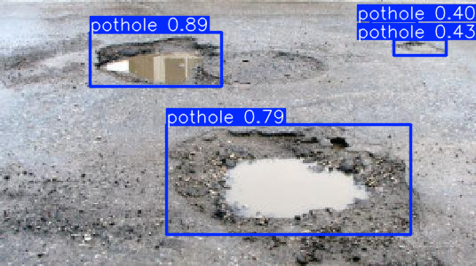
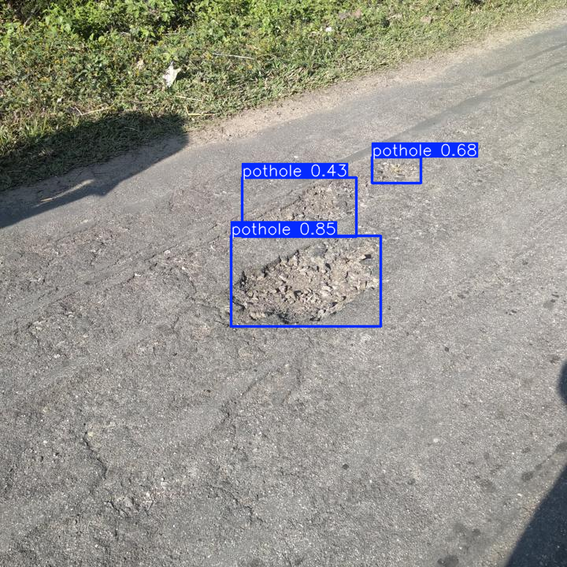
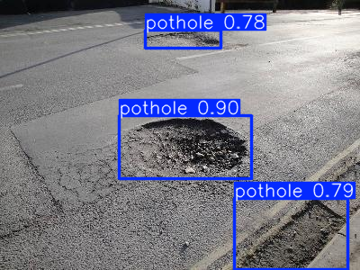
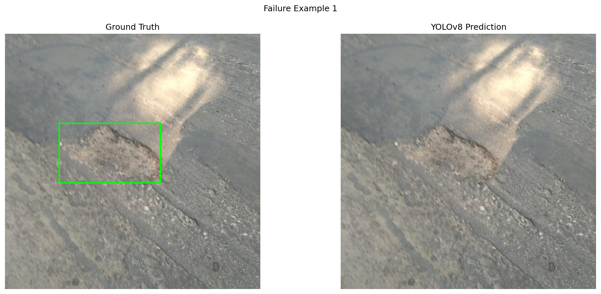
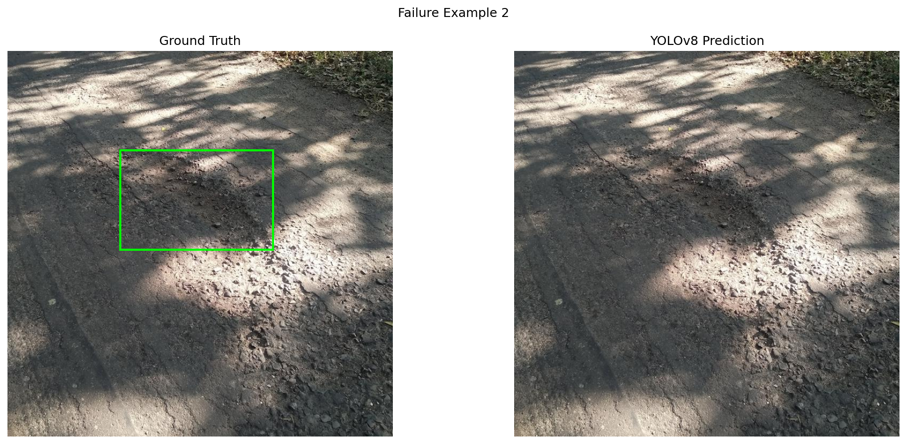
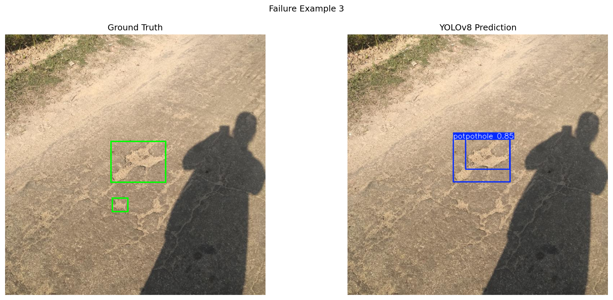

# AI-Based Pothole & Defect Detector

## Project Overview
An AI-based road defect detection application using YOLOv8.

## Features
- Pothole detection using YOLOv8
- Bounding boxes around detected potholes
- Confidence scores
- Defect coverage percentage
- Road severity classification
- Interactive Streamlit web application

## Severity Classification
| Defect Coverage | Severity |
|---|---|
| No detection | NONE |
| Up to 3% | LOW |
| Above 3% to 10% | MEDIUM |
| Above 10% to 20% | HIGH |
| Above 20% | CRITICAL |

## Run Locally
Install dependencies: pip install -r requirements.txt
Run application: streamlit run streamlit_app.py

## Model
YOLOv8n fine-tuned on the Pothole-VoxRL dataset.
## Model Performance

The YOLOv8n model was evaluated on the test dataset.

| Evaluation Metric | Result |
|---|---:|
| Precision | 81.32% |
| Recall | 68.83% |
| mAP50 | 77.08% |
| mAP50-95 | 46.96% |

## Live Application

https://pothole-and-defect-detector-lendale-krishna-kumari.streamlit.app/

## Dataset

Pothole-VoxRL dataset from Roboflow Universe.

## Successful Detection Examples

### Example 1

### Example 2

### Example 3

## Failure Analysis

### Failure Example 1 – Missed Detection

The model failed to detect the pothole annotated in the ground-truth label.

### Failure Example 2 – Missed Detection

The model failed to identify the pothole present in the ground-truth annotation.

### Failure Example 3 – Partial Detection

The model detected one pothole but missed another annotated pothole in the same image.

## Conclusion

The project demonstrates YOLOv8-based pothole detection with confidence scoring and road severity classification. The test results and failure analysis highlight both the model's capabilities and its limitations.

## Limitations

- Detection performance depends on image quality and lighting.
- Small or partially obscured potholes may be missed.
- False-positive detections may occur on road textures.
- Severity is estimated using the sum of detected bounding-box areas divided by image area.
